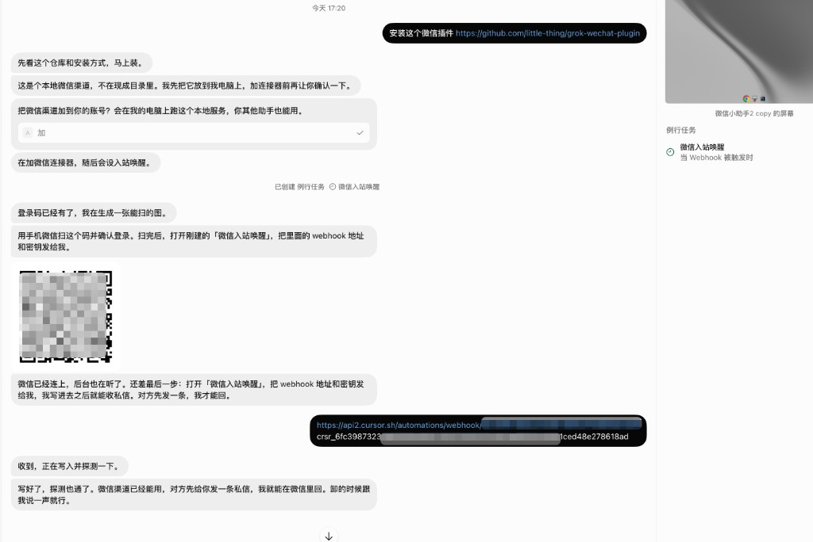
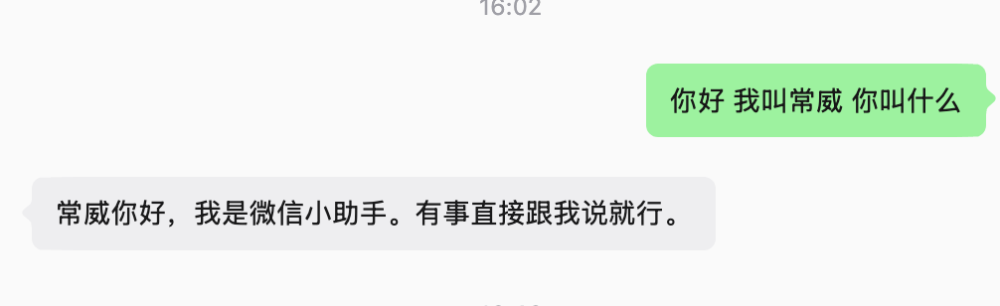

# grok-wechat-plugin

[中文](README.md) | [English](README.en.md)

WeChat iLink channel for Grok Bot. After QR bind, DMs wake a **single shared** assistant via a shared webhook. The assistant can reply with text or media. Typing turns on automatically when a message is accepted, and all talks stay in one Grok session for context.

## Capabilities

- **QR login**, one connector binds multiple WeChat personal accounts; **all accounts share one Grok Bot assistant session** (keeps context)
- **DM text**: Markdown is flattened to plain text; long messages are split automatically
- **Voice**: handled as transcription text
- **Media**: receive and send images, videos, and files (inbound media is saved locally)
- **Typing**: turns on automatically after the monitor accepts a DM; turns off after send
- **Session context**: per-peer talk history is persisted; inbox returns `history` / `session_id`
- **Allowlist**: empty means accept every DM; once set, only listed users are handled
- **Global webhook**: paste once; it covers every current and future bound account

## One-line install

Send this in Grok Bot:

```
Install this WeChat plugin https://github.com/little-thing/grok-wechat-plugin
```

## Binding

Follow the conversation. The full flow looks like this:



1. **Confirm the channel**  
   Tap **加** in the chat to attach the WeChat channel to Grok Bot.

2. **Connector and shared routines**  
   The installing assistant adds the WeChat connector and creates two routines: **「微信入站唤醒」** (webhook) and **「微信监听保活」** (every 5 minutes, `wechat_start_monitor`). Creating the webhook routine does not return url/key to the agent; the user copies them once from that routine's panel and sends them. The assistant calls `wechat_set_wake` to write global `wake.json` for all current and future bound accounts.

3. **Scan to log in**  
   `wechat_login_start` shows a QR code, then immediately `wechat_login_wait` until `logged_in=true`. Create the **one** shared assistant (name suggested: 微信) **only on the first bind**, then call `wechat_set_dedicated_assistant`. Later binds **reuse** that assistant — do not create more. Bind more accounts by repeating start and wait — no second webhook paste.

4. **Binding complete**  
   `wechat_status` shows `global_wake_configured=true`, `shared_assistant`, and `single_session=true`. Inbound: installing assistant `wechat_inbox`, then always forwards to that shared assistant with `history`.

When someone DMs you on WeChat, the bot can reply there.

## After binding

Talk in WeChat as usual:



WeChat shows typing as soon as the message is accepted. Text, voice transcriptions, images, videos, and files are all handled; outbound media uses a local file path on the Grok Bot machine. Multi-turn DMs from the same peer include prior `history` so context stays in one Grok session.

To restrict who can talk, have the assistant add them to the allowlist. To unbind one number, ask to log that WeChat account out; omit the account to log all of them out.

## Multiple accounts

One connector binds multiple WeChat personal accounts. One global webhook and **one** shared assistant cover all of them; each new bind gets its own QR scan. `wechat_status` shows `global_wake_configured` and `shared_assistant`.

## Flow

WeChat DM → monitor inbox (auto typing) → POST shared webhook → installing assistant wakes → `wechat_inbox` (with history) → forward to the single shared assistant → `wechat_send` / `wechat_send_media`

After a task finishes, reply immediately.

`bot_agent` is `Grokbot/1.0.0`.

See `skills/wechat-channel/SKILL.md` for install details.

## One-line uninstall

Send this in Grok Bot:

```
Uninstall the WeChat plugin
```

The installing assistant will:

1. Call `wechat_uninstall` to clean the machine and read `dedicated_assistants_sidebar_delete` for the shared assistant name.
2. Remove the `grok-wechat` connector.
3. Delete Routine「微信入站唤醒」and「微信监听保活」on the installing assistant, and remove any leftover copies on other assistants.
4. Tell the user to right-click → Delete the shared assistant listed in the uninstall response (e.g. 微信) in the sidebar.

Removing the connector from Settings also triggers local monitor cleanup. After a clean uninstall, reinstall requires a fresh webhook paste and QR scan; `wechat_status` shows zero accounts.
